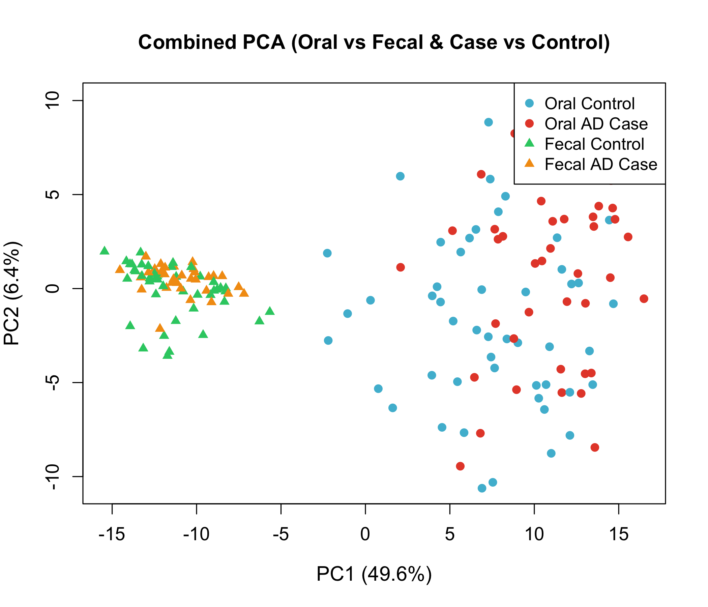
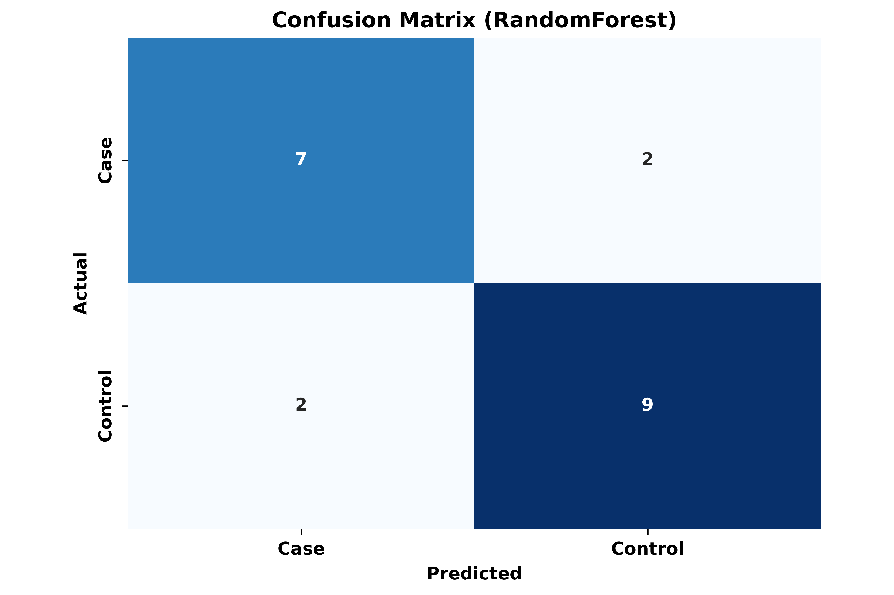
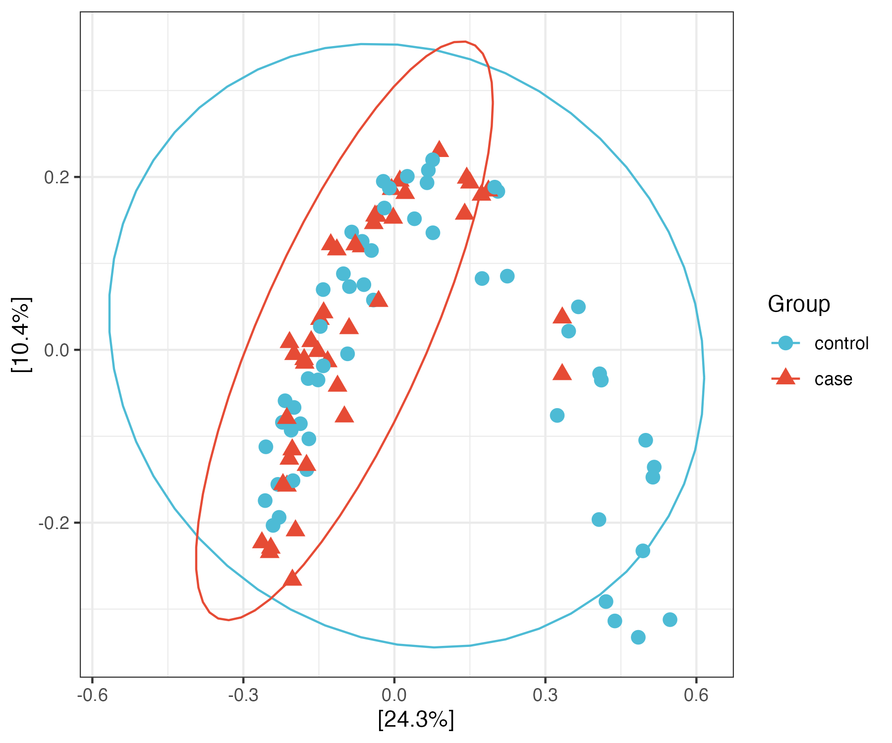
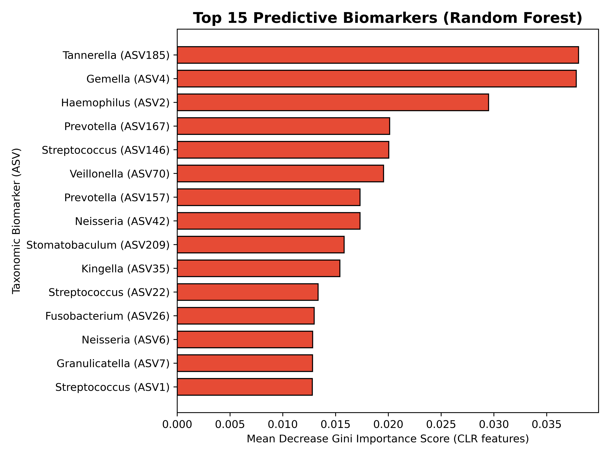

<div align="center">

# 🦠 Oral Microbiome Dysbiosis is Associated with Alzheimer's Disease

### Integrated Taxonomic, Functional & Machine-Learning Insights from a Vancouver Cohort

**Edward Jenner Tettevi** · **David Larbi Simpong** · **Robert Peter Biney** · **Mike Y. Osei-Atweneboana**

[](https://www.ncbi.nlm.nih.gov/bioproject/PRJNA770746)
[]()
[]()
[]()
[]()
[]()

_A reproducible 16S rRNA amplicon metagenomics pipeline linking oral microbiome structure,
function, and diagnostic prediction to Alzheimer's disease._

</div>

---

## ✨ Highlights

- 🔬 **Secondary re-analysis** of publicly deposited 16S rRNA sequencing data (BioProject `PRJNA770746`)
- 🧬 **96 oral** (43 AD / 53 control) + **78 fecal** (32 AD / 46 control) = **174 samples analysed**
- 💊 **ANCOM-BC2** compositional differential-abundance testing across 5 taxonomic ranks
- 🧠 **PICRUSt2** predicted functional profiling (biosynthetic pathways enriched in AD)
- 🤖 **Random Forest** classifier reaching **AUC = 0.85** (95% CI 0.72–0.98)
- ⚖️ Fully reproducible end-to-end workflow (Python + R, conda + pip)

---

## 📖 Key Findings

| Finding | Detail | Status |
|---|---|---|
| **Phylum enrichment** | `Bacteroidota` enriched in AD | ✅ significant (LFC +0.75, q = 0.037) |
| **Directional shifts** | `Proteobacteria` ↑, `Actinobacteriota` ↓ | directional, non-significant |
| **Genus markers** | `SUP05`, `Gemella`, `Fusobacterium` ↑; `F0332`, `Selenomonas` ↓ | significant |
| **Alpha diversity** | Increased in AD (community destabilization) | Chao1 p = 0.003 |
| **Functional potential** | Biosynthetic pathways ↑ (peptidoglycan, thiamine, phospholipid) | 58% rise |
| **Diagnostic ML** | Random Forest **AUC 0.85** | sens. 77.8%, spec. 81.8% |

---

## 🩺 Study Design

| Metric | Oral | Fecal | Combined |
|---|---|---|---|
| **Enrolled participants** | 99 | 99 | 99 |
| **Samples analysed** | **96** (43 case / 53 ctrl) | **78** (32 case / 46 ctrl) | **174** |
| **Excluded** | 3 (low depth/QC) | 21 | 24 |
| **Sequencing** | Illumina MiSeq, 16S V3–V4 | Illumina MiSeq, 16S V3–V4 | — |

> ✅ Corrected to the finalized analysis: **96 oral / 78 fecal / 174 combined**.
> Arc-shaped body-site separation in combined PCA driven by sample site (PC1 = 49.6%).

---

## 🔬 Methods Pipeline

```
 raw FASTQ (SRA)
     │  01_download_sra_data.sh + 02_download_and_process_fecal.sh
     ▼
 Quality Control ─────────── 03_run_fastp_automatic.sh  (fastp, Q≥20)
     │                       04_run_cutadapt_v3v4.sh     (adapters, primers)
     ▼
 Host Decontamination ────── 05_run_bowtie2_decontam.sh  (hg38; bowtie2, samtools)
     │
     ▼
 ASV Inference ───────────── 06_dada2_16S_pipeline_standalone.R (+ 07–10 fecal DADA2, batch)
     │
     ├──► HOMD Taxonomy ───────── 11_setup_homd.R → 16_assign_fecal_taxonomy.R
     ├──► Sample Selection ────── 17_analyze_sample_selection.R
     ├──► Abundance ───────────── 19_abundance_analysis.R
     ├──► Alpha/Beta Diversity ── 20_alpha_beta_analysis.py   (vegan, scikit-bio)
     ├──► Differential ────────── 21_improved_differential_analysis.R
     ├──► Function (PICRUSt2) ──── 27_picrust.py + 28_pathway-tools.py
     ├──► Machine Learning ─────── 29_microbiome_ml.py        (scikit-learn)
     └──► Combined & Corrected ── 32_run_fecal_and_combined_analysis.R → 34_run_ancombc2_phylum.R
```

---

## 🖼️ Figures

### Combined Oral + Fecal Microbiome (PCA)

<p align="center">
  
</p>

> 174 samples, genus-level CLR-transformed abundances. Separation is driven primarily by
> **body site** (PC1 = 49.6%) with a significant independent disease effect (PERMANOVA R² = 1.03%, p = 0.020).

### Machine Learning Classification

<p align="center">
  
  
</p>

### Beta Diversity & Feature Importance

<p align="center">
  
  
</p>

---

## 📂 Repository Structure

```
ad_oral_microbiome/
├── README.md                  ← You are here
├── LICENSE                    MIT License
├── environment.yml            Conda environment (Python + R + tools)
├── requirements.txt           Python dependencies
├── sample_metadata.csv        Sample metadata for all runs
│
├── scripts/                  # 36 scripts — sequential execution order
│   │
│   │  01–02  Data acquisition
│   ├── 01_download_sra_data.sh
│   ├── 02_download_and_process_fecal.sh
│   │
│   │  03–05  QC & decontamination
│   ├── 03_run_fastp_automatic.sh
│   ├── 04_run_cutadapt_v3v4.sh
│   ├── 05_run_bowtie2_decontam.sh
│   │
│   │  06–10  DADA2 ASV inference
│   ├── 06_dada2_16S_pipeline_standalone.R
│   ├── 07_fecal_dada2_simple.R
│   ├── 08_fecal_dada2_analysis.R
│   ├── 09_process_fecal_samples.R
│   ├── 10_process_fecal_batch.R
│   │
│   │  11–16  HOMD taxonomy
│   ├── 11_setup_homd.R
│   ├── 12_homd_fast_taxonomy.R
│   ├── 13_homd_priority_taxonomy.R
│   ├── 14_run_homd_species.R
│   ├── 15_species_level_assignment.R
│   ├── 16_assign_fecal_taxonomy.R
│   │
│   │  17–18  Sample selection
│   ├── 17_analyze_sample_selection.R
│   ├── 18_identify_excluded_samples.R
│   │
│   │  19–26  Abundance, diversity & differential
│   ├── 19_abundance_analysis.R
│   ├── 20_alpha_beta_analysis.py
│   ├── 21_improved_differential_analysis.R
│   ├── 22_run_improved_analysis.R
│   ├── 23_improved_analysis_clean.R
│   ├── 24_improved_analysis_final.R
│   ├── 25_improved_analysis_v2.R
│   ├── 26_full_analysis.R
│   │
│   │  27–29  Functional & ML
│   ├── 27_picrust.py
│   ├── 28_pathway-tools.py
│   ├── 29_microbiome_ml.py
│   │
│   │  30–34  Combined & corrected analyses
│   ├── 30_combined_analysis.R
│   ├── 31_fecal_analysis_status.R
│   ├── 32_run_fecal_and_combined_analysis.R
│   ├── 33_regenerate_combined.R
│   ├── 34_run_ancombc2_phylum.R
│   │
│   │  35–36  Visualization & manuscript
│   ├── 35_improved_visualization.R
│   └── 36_generate_manuscript_updates.py
│
├── dada2/                     # DADA2 pipeline outputs
├── data/                      # Cohort & sample-level data (CSV)
├── results/                   # Analysis result tables (CSV)
├── figures/                   # All figures (PNG / JPG / EPS)
├── manuscript/                # Manuscript versions (.docx)
├── review/                    # Reviewer-response materials
├── supplementary/             # Supplementary materials
└── env/                       # (conda env, created locally)
```

---

## 📊 Data Files (`.csv`)

### Cohort & Sample Metadata — `data/`

| File | Description |
|---|---|
| `bioproject_summary.csv` | BioProject-level summary |
| `sample_selection_table.csv` | **198-run** inclusion / exclusion status |
| `complete_runs_inclusion_table.csv` | Full SRR run table with demographics |
| `demographics_summary_table.csv` | Age / sex / BMI / MoCA by group (96-oral route) |

### Analysis Results — `results/`

| File | Description |
|---|---|
| `ancombc2_phylum_results.csv` | ANCOM-BC2 **phylum-level** results (Bacteroidota q = 0.037) |
| `ancombc2_class_results.csv` | Class-level results |
| `ancombc2_order_results.csv` | Order-level results |
| `ancombc2_family_results.csv` | Family-level results |
| `ancombc2_genus_results.csv` | Genus-level results |
| `oral_ancombc2_results.csv` | Combined oral ANCOM-BC2 output |
| `combined_beta_pca.csv` | **174-sample** combined oral+fecal PCA coordinates |
| `combined_beta_pca_174.csv` | Same as above (explicit label) |
| `fecal_alpha_diversity.csv` | Fecal alpha-diversity metrics |
| `fecal_beta_pca.csv` | Fecal beta-diversity PCA |
| `fecal_differential_abundance.csv` | Fecal differential abundance |
| `rf_feature_importance.csv` | Random Forest Gini importance scores |

---

## 🖌️ Figure Files (`.png` / `.eps` / `.jpg`)

### Main Figures — `figures/`

| File | Figure |
|---|---|
| `Fig. 2.eps` / `Fig. 2.jpg` | PCoA + ANCOM-BC2 log-fold changes (vector EPS) |
| `Fig. 3.jpg` | Chao1 / Fisher / Observed alpha diversity |
| `Fig. 4.jpg` | Beta diversity (NMDS / PCoA) |
| `Fig. 5.jpg` | PICRUSt2 pathway analysis |
| `Fig._6A.png` | ML ROC curves (all models) |
| `Fig._6B.png` | Confusion matrices |
| `Fig._7.png` | Random Forest feature importance |
| `Fig_8_combined_pca.png` | **Combined oral+fecal PCA (174 samples)** |

### Supplementary Figures — `figures/`

| File | Description |
|---|---|
| `Supplementary_Fig_2C.png` | Order-level differential abundance |
| `Supplementary_Fig_2D.png` | Family-level differential abundance |
| `Supplementary_Fig_2E.png` | Genus-level differential abundance |
| `Supplementary_Fig_5C.png` | Pathway volcano plot |

### Model & Utility Plots — `figures/`

| File | Description |
|---|---|
| `ml_multipanel_roc_curve.png` | All-model ROC curves (multipanel) |
| `ml_multipanel_confusion_matrix.png` | All-model confusion matrices |
| `ml_RandomForest_roc_curve.png` / `..._confusion_matrix.png` | RF ROC / confusion matrix |
| `ml_GradientBoosting_roc_curve.png` / `..._confusion_matrix.png` | GBM ROC / confusion matrix |
| `ml_LogisticRegression_roc_curve.png` / `..._confusion_matrix.png` | LogReg ROC / confusion matrix |
| `ml_SVM_roc_curve.png` / `..._confusion_matrix.png` | SVM ROC / confusion matrix |
| `oral_pcoa_bray.png` | Oral beta diversity PCoA |
| `rf_feature_importance.png` | RF feature importance |

---

## 🔁 Reproducibility

### Environment Setup

```bash
# Option A — Conda (recommended)
conda env create -f environment.yml
conda activate oral_microbiome_analysis

# Option B — pip (Python-only)
pip install -r requirements.txt
```

### Data Access

- **Raw reads:** NCBI SRA — BioProject [`PRJNA770746`](https://www.ncbi.nlm.nih.gov/bioproject/PRJNA770746)
- **ASV table:** `dada2/asv_table.tsv`
- **Taxonomy:** `dada2/asv_taxonomy.tsv`
- **Metadata:** `sample_metadata.csv`

### Run order — sequential `01` → `36`

```bash
# ── 01–02  Download ───────────────────────────────────────
bash scripts/01_download_sra_data.sh
bash scripts/02_download_and_process_fecal.sh

# ── 03–05  QC & decontamination ───────────────────────────
bash scripts/03_run_fastp_automatic.sh
bash scripts/04_run_cutadapt_v3v4.sh
bash scripts/05_run_bowtie2_decontam.sh

# ── 06–10  DADA2 ASV inference ────────────────────────────
Rscript scripts/06_dada2_16S_pipeline_standalone.R
Rscript scripts/07_fecal_dada2_simple.R
Rscript scripts/08_fecal_dada2_analysis.R
Rscript scripts/09_process_fecal_samples.R
Rscript scripts/10_process_fecal_batch.R

# ── 11–16  HOMD taxonomy ─────────────────────────────────
Rscript scripts/11_setup_homd.R
Rscript scripts/12_homd_fast_taxonomy.R
Rscript scripts/13_homd_priority_taxonomy.R
Rscript scripts/14_run_homd_species.R
Rscript scripts/15_species_level_assignment.R
Rscript scripts/16_assign_fecal_taxonomy.R

# ── 17–18  Sample selection ───────────────────────────────
Rscript scripts/17_analyze_sample_selection.R
Rscript scripts/18_identify_excluded_samples.R

# ── 19–26  Abundance, diversity & differential ────────────
Rscript scripts/19_abundance_analysis.R
python  scripts/20_alpha_beta_analysis.py
Rscript scripts/21_improved_differential_analysis.R
Rscript scripts/22_run_improved_analysis.R
Rscript scripts/23_improved_analysis_clean.R
Rscript scripts/24_improved_analysis_final.R
Rscript scripts/25_improved_analysis_v2.R
Rscript scripts/26_full_analysis.R

# ── 27–28  Functional prediction ──────────────────────────
python scripts/27_picrust.py
python scripts/28_pathway-tools.py                  # optional Pathway Tools

# ── 29     Machine learning ──────────────────────────────
python scripts/29_microbiome_ml.py

# ── 30–34  Combined & corrected analyses ─────────────────
Rscript scripts/30_combined_analysis.R
Rscript scripts/31_fecal_analysis_status.R
Rscript scripts/32_run_fecal_and_combined_analysis.R
Rscript scripts/33_regenerate_combined.R            # corrected 174-sample PCA
Rscript scripts/34_run_ancombc2_phylum.R            # corrected phylum q=0.037

# ── 35–36  Visualization & manuscript ────────────────────
Rscript scripts/35_improved_visualization.R
python  scripts/36_generate_manuscript_updates.py
```

> **Note:** The 22 additional scripts in `scripts/` include batch-processing helpers,
> HOMD taxonomy pipelines, improved-analysis iterations, and corrected final-analysis
> scripts used to produce the results in this repository.

---

## 📜 Citation

If you use this pipeline, data, or results, please cite:

```bibtex
@article{tettevi2026oral,
  title   = {Oral Microbiome Dysbiosis is Associated with Alzheimer's Disease:
             Integrated Taxonomic, Functional, and Machine-Learning Insights
             from a Vancouver Cohort},
  author  = {Tettevi, Edward Jenner and Simpong, David Larbi and
             Biney, Robert Peter and Osei-Atweneboana, Mike Y.},
  journal = {The Microbe},
  year    = {2026},
  note    = {Revised manuscript submission}
}
```

---

## 📬 Contact

**Edward Jenner Tettevi** — [ejtettevi@gmail.com](mailto:ejtettevi@gmail.com)

<p align="center"><sub>MIT License · Built with reproducibility in mind 🧬</sub></p>
